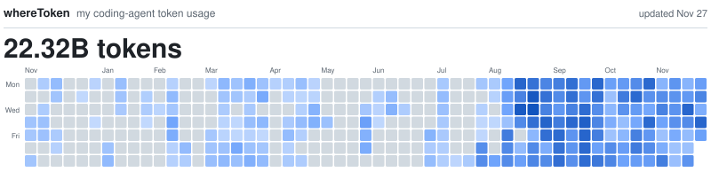

  <a href="https://rainhuang0220.github.io/whereToken/profile/">
    <picture>
      <source media="(prefers-color-scheme: dark)" srcset="https://raw.githubusercontent.com/rainhuang0220/rainhuang0220/main/wheretoken/preview-dark.svg?v=951d66c60b3e8373d190e021ff75ab6ac764bbb648fb66d6d64dab1dd2ade144-a70ff0e4fca76aa26bbf2a772ac3f829b244e9d4a086e40fb3252ea39e8e9a84">
      <source media="(prefers-color-scheme: light)" srcset="https://raw.githubusercontent.com/rainhuang0220/rainhuang0220/main/wheretoken/preview-light.svg?v=951d66c60b3e8373d190e021ff75ab6ac764bbb648fb66d6d64dab1dd2ade144-a70ff0e4fca76aa26bbf2a772ac3f829b244e9d4a086e40fb3252ea39e8e9a84">
      
    </picture>
  </a>

