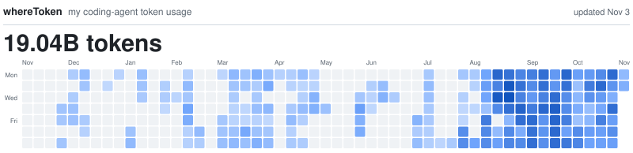

  <a href="https://rainhuang0220.github.io/whereToken/profile/">
    <picture>
      <source media="(prefers-color-scheme: dark)" srcset="https://raw.githubusercontent.com/rainhuang0220/rainhuang0220/main/wheretoken/preview-dark.svg?v=36a6d98a998bcfa17df6f572645e9aa8bbec727542260ab6dcdbf78059bc58d2-7d1263655bebd4dd8d922c1c9857fe7db35ee0e3ca16ae75dfa7786ade4efbf8">
      <source media="(prefers-color-scheme: light)" srcset="https://raw.githubusercontent.com/rainhuang0220/rainhuang0220/main/wheretoken/preview-light.svg?v=36a6d98a998bcfa17df6f572645e9aa8bbec727542260ab6dcdbf78059bc58d2-7d1263655bebd4dd8d922c1c9857fe7db35ee0e3ca16ae75dfa7786ade4efbf8">
      
    </picture>
  </a>

